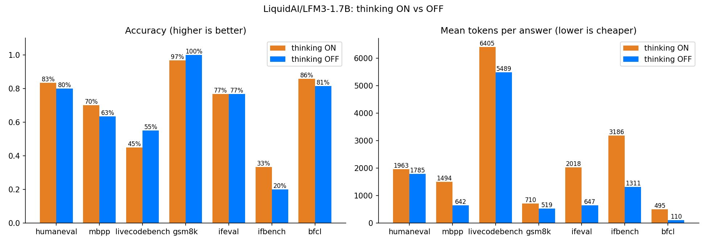

# Baseline v1: LFM3-1.7B thinking ON vs OFF

First run of `notebooks/LFM3_Thinking_ON_vs_OFF.ipynb` on Kaggle (T4, float16, plain transformers), 2026-11-09.

Settings: 30 questions per benchmark (LiveCodeBench 20, BFCL 70 = 10 from each of 7 categories), `max_new_tokens` 4096 (8192 for LiveCodeBench), seed 0, Liquid's recommended sampling, **identical settings for both modes**.

> Small samples: one question = 3.3 points (5 for LiveCodeBench). Differences under ~10 points are noise. This run is a first look, not the final benchmark.

## Headline numbers

| Benchmark | ON acc | OFF acc | ON tokens | OFF tokens | OFF uses x fewer |
|---|---|---|---|---|---|
| HumanEval+ | 83.3 | 80.0 | 1963 | 1785 | 1.1x |
| MBPP+ | 70.0 | 63.3 | 1494 | 642 | 2.3x |
| LiveCodeBench v6 | 45.0 | 55.0 | 6405 | 5489 | 1.2x |
| GSM8K | 96.7 | 100.0 | 710 | 519 | 1.4x |
| IFEval | 76.7 | 76.7 | 2018 | 647 | 3.1x |
| IFBench | 33.3 | 20.0 | 3186 | 1311 | 2.4x |
| BFCL (single-turn) | 85.7 | 81.4 | 495 | 110 | 4.5x |
| **Average** | **70.1** | **68.1** | **2324** | **1500** | **2.3x** |

Full table with truncation, leak rate and seconds per answer: [summary.md](summary.md).

## What we found

### 1. "Thinking OFF" does not really switch thinking off

With `enable_thinking=False` the prompt ends in an empty `<think></think>`, but the model often **starts reasoning anyway in plain text and closes it with its own `</think>`** before answering:

| Benchmark | OFF answers that reasoned anyway | of those correct |
|---|---|---|
| HumanEval+ | 25 / 30 (83%) | 21 |
| LiveCodeBench | 10 / 20 (50%) | 9 |
| GSM8K | 7 / 30 | 7 |
| IFBench | 5 / 30 | 2 |
| BFCL | 6 / 70 | 4 |
| MBPP+ | 2 / 30 | 1 |
| IFEval | 2 / 30 | 2 |

So on code, OFF mode is mostly *thinking without the tag*. That is why OFF saves almost no tokens on HumanEval+ (1.1x) and LiveCodeBench (1.2x), and why OFF looks as good as ON there. This matches the model card's warning that thinking-off behaviour is inconsistent.

Another 15 OFF answers (mostly code and IFBench) reasoned in plain text without ever closing it and ran into the token limit.

### 2. When OFF does answer directly, it is very cheap

Answers with no reasoning at all (median tokens): BFCL **43** (53/64 correct), MBPP+ 158 (18/26), GSM8K 168 (23/23 correct), IFEval 249 (21/26). Compare ON: 284–1646 median tokens. This is the behaviour we want to make reliable.

### 3. ON's score is held back by the token limit, not by wrong answers

Almost every ON loss is a truncated answer that never finished thinking:

| Benchmark | ON truncated | ON accuracy on answers that finished |
|---|---|---|
| HumanEval+ | 13% | 25 / 26 (96%) |
| MBPP+ | 13% | 21 / 26 (81%) |
| LiveCodeBench | 50% | 9 / 10 (90%) |
| GSM8K | 3% | 29 / 29 (100%) |
| IFEval | 23% | 23 / 23 (100%) |
| IFBench | 50% | 9 / 15 (60%) |
| BFCL | 0% | 60 / 70 (86%) |

Liquid's published numbers use no output limit, so they are higher (IFEval 96.66, IFBench 73.03, LiveCodeBench 73.46). With a realistic budget (4096 tokens is already a lot for a phone), thinking mode often runs out before answering.

### 4. Speed

Plain transformers on a T4 generates about **24 tokens/s** for a single answer in both modes, so time saved is simply tokens saved. Example: a BFCL tool call took 4.3 s with thinking ON vs 1.2 s OFF.

## Conclusion

- The accuracy gap between ON and OFF is small on average (about 2 points), **but only because OFF secretly thinks on hard tasks.** Real direct answers are fast but unreliable to trigger.
- Thinking ON is accurate when it finishes, but is too long for a 4K budget on instruction-following and competitive code.
- That makes the project's goal concrete: **train the model to answer directly and reliably** (no hidden reasoning, no runaway text), keeping ON-level accuracy on the easy-to-medium tasks, with a short reasoning fallback only where needed. Target metrics for the fine-tune: leak rate near 0%, truncation near 0%, median tokens like the direct-answer numbers above, accuracy close to "ON when it finishes".

## Next

1. Bigger baseline (100–300 per benchmark) to get tight error bars.
2. Measure at Q4 GGUF (llama.cpp), where thinking-off models are known to degrade more.
3. Training data: self-generated, verified answers on prompts separate from every eval set.

## Files

| File | Content |
|---|---|
| `summary.md` / `summary.csv` | Per mode and benchmark: accuracy, tokens, truncation, leak rate, time |
| `on_vs_off.csv` | Gap table |
| `on_vs_off.png` | Charts |
| `per_question_outcomes.csv` | Every question: right in ON, OFF, both, neither |
| `all_answers.jsonl` | Every raw model answer with its parsed reasoning, answer and score |
| `speed_test.csv` | Single-answer speed test |
| `template_check.txt` | Rendered chat template for both modes |
