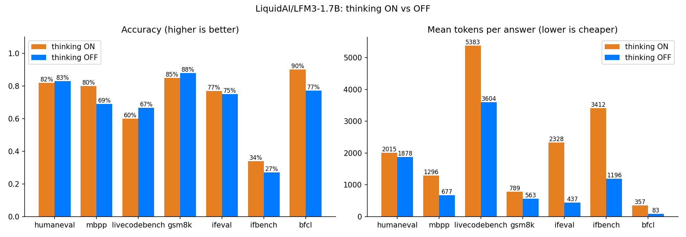

# Baseline v2: LFM3-1.7B thinking ON vs OFF (100 per benchmark)

Second run of `notebooks/LFM3_Thinking_ON_vs_OFF.ipynb` on Kaggle (2x T4, float16, transformers), 2026-11-10.

Settings: 100 questions each for HumanEval+, MBPP+, GSM8K, IFEval and IFBench, 30 for LiveCodeBench v6, 70 for BFCL (10 from each of 7 single-turn categories). That makes **1,200 answers**. `max_new_tokens` was 4096 (8192 for LiveCodeBench), with seed 0 and Liquid's recommended sampling. **The settings were identical for both modes.**

## Headline numbers

| Benchmark | ON acc | OFF acc | Gap | ON tokens | OFF tokens | OFF uses x fewer |
|---|---|---|---|---|---|---|
| HumanEval+ | 82.0 | 83.0 | -1.0 | 2015 | 1878 | 1.1x |
| MBPP+ | 80.0 | 69.0 | **+11.0** | 1296 | 677 | 1.9x |
| LiveCodeBench v6 | 60.0 | 66.7 | -6.7 | 5383 | 3604 | 1.5x |
| GSM8K | 85.0 | 88.0 | -3.0 | 789 | 563 | 1.4x |
| IFEval | 77.0 | 75.0 | +2.0 | 2328 | 437 | 5.3x |
| IFBench | 34.0 | 27.0 | +7.0 | 3412 | 1196 | 2.9x |
| BFCL (single-turn) | 90.0 | 77.1 | **+12.9** | 357 | 83 | 4.3x |
| **Average** | **73.0** | **69.4** | **+3.6** | **2226** | **1206** | **2.6x** |

Paired comparison: each question was answered in both modes, so we count the questions only one mode got right.

| Benchmark | Only ON right | Only OFF right | Clear difference? |
|---|---|---|---|
| MBPP+ | 13 | 2 | **yes** (p ≈ 0.007, exact McNemar) |
| BFCL | 9 | 0 | **yes** (p ≈ 0.004) |
| IFBench | 18 | 11 | no (p ≈ 0.27) |
| IFEval | 12 | 10 | no |
| HumanEval+ | 4 | 5 | no |
| LiveCodeBench | 2 | 4 | no |
| GSM8K | 0 | 3 | no |

The full table, with truncation rate, leak rate and time, is in [summary.md](summary.md).

## What we found

### 1. Confirmed: "thinking OFF" often still thinks

With `enable_thinking=False`, the model often reasons in plain text anyway and closes the reasoning with its own `</think>`:

| Benchmark | OFF answers that reasoned anyway |
|---|---|
| HumanEval+ | **70 / 100** |
| LiveCodeBench | **18 / 30** |
| MBPP+ | 20 / 100 |
| GSM8K | 19 / 100 |
| IFBench | 8 / 100 |
| IFEval | 3 / 100 |
| BFCL | 3 / 70 |

Overall, 141 of 600 "OFF" answers (24%) contained hidden reasoning. This is why OFF matches ON on HumanEval+ and LiveCodeBench: on those, OFF mode mostly *is* thinking, just without the tag. It's also why it saves so few tokens there (1.1–1.5x). The first run showed the same pattern, so it's a property of the model, not noise.

### 2. Where OFF really answers directly, it is cheap but loses accuracy

Answers with no reasoning at all, thinking OFF:

| Benchmark | Direct answers | Correct | Median tokens |
|---|---|---|---|
| BFCL | 67 | 53 (79%) | **46** |
| GSM8K | 79 | 74 (94%) | 189 |
| MBPP+ | 74 | 55 (74%) | 139 |
| IFEval | 95 | 73 (77%) | 234 |
| IFBench | 80 | 20 (25%) | 422 |

The two gaps that are clearly real (MBPP+ and BFCL) are on the tasks where OFF *does* answer directly. On BFCL, OFF mostly loses on calls that need several tools at once: on *parallel* it gets 6/10 vs 10/10 with thinking, and on *parallel_multiple* 7/10 vs 9/10.

### 3. Thinking ON is accurate when it finishes, but often runs out of budget

| Benchmark | ON answers cut off | ON accuracy on answers that finished |
|---|---|---|
| IFBench | **58%** | 31 / 42 (74%) |
| LiveCodeBench | 37% | 18 / 19 (95%) |
| IFEval | 19% | 76 / 81 (94%) |
| HumanEval+ | 11% | 82 / 89 (92%) |
| MBPP+ | 8% | 80 / 92 (87%) |
| GSM8K | 3% | 85 / 97 (88%) |
| BFCL | 0% | 63 / 70 (90%) |

Overall, 110 of 600 ON answers (18%) hit the token limit, compared with 39 of 600 OFF answers (6.5%). Liquid's published scores use no output limit, which is why they are higher (IFEval 96.66, IFBench 73.03, LiveCodeBench 73.46).

The GSM8K misses (12 wrong in both modes) are genuine arithmetic or reading mistakes. We checked them by hand against the reference answers.

### 4. Speed

A single answer streams at about **25 tokens/s** in both modes on a T4. Time saved is therefore tokens saved. For example, a typical BFCL tool call took 3.4 s with thinking and 1.4 s without, and an IFEval answer took 138 s vs 14 s.

## Conclusion

- **Thinking OFF is not a reliable fast mode in LFM3-1.7B.** On hard code it secretly thinks, so it saves almost nothing. Where it answers directly, it is 2–5x cheaper but loses clear accuracy on MBPP+ (11 points) and on tool calls (13 points, mostly on parallel calls).
- **Thinking ON is accurate (87–95% on finished answers) but too long.** 18% of its answers hit the 4K/8K limit before finishing, and on IFBench 58% did.
- **The fine-tuning target is now measured and concrete:** an "instant" mode with **no hidden reasoning**, **almost no cut-off answers**, token counts like the direct OFF answers above (about 50–250 tokens), and accuracy closer to what thinking ON reaches when it finishes. The main places to win are MBPP+, BFCL parallel calls and IFBench.

## Run notes

- Generation took about 2 h on 2x T4 (03:50 to 05:53), at about 240 tokens/s in total.
- Both GPU workers started at batch 64 (about 570 tokens/s each), but ran out of memory within the first minutes and dropped to batch 8–10 for the rest of the run. That is why the run was slower than planned. The likely cause is that re-reading a long prompt plus answer for a big batch needs a lot of memory at once. Fixing this (for example, raising the batch size back up after memory frees, or smaller chunks for long answers) could make the next run about 3–4x faster.
- Both workers passed the start-up check: generating in chunks gave exactly the same text as generating in one go (48/48 tokens).

## Files

| File | Content |
|---|---|
| `summary.md` / `summary.csv` | For each mode and benchmark: accuracy, tokens, truncation, leak rate, time |
| `on_vs_off.csv` | Gap table |
| `on_vs_off.png` | Charts |
| `per_question_outcomes.csv` | Every question: right in ON, OFF, both, or neither |
| `all_answers.jsonl.gz` | Every raw model answer with its parsed reasoning, answer and score (gzip) |
| `speed_test.csv` | Single-answer speed test |
| `worker_gpu*.log` | GPU worker logs (speed, memory fallbacks) |
| `template_check.txt` | Rendered chat template for both modes |
