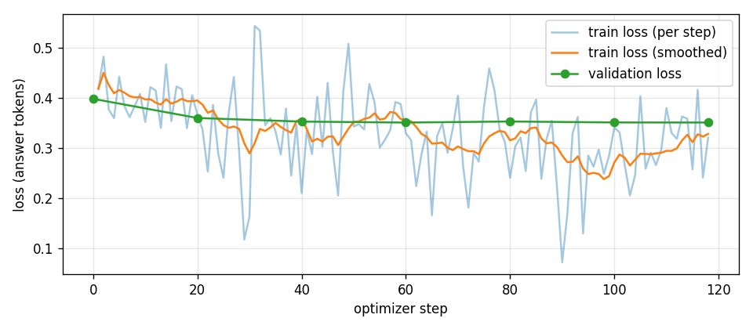

# Step 3: LoRA fine-tune (first run)

Output of `notebooks/Step3_LoRA_Finetune.ipynb` on Kaggle (T4, float16), 2026-11-10.

## What was trained

| | |
|---|---|
| Base model | LiquidAI/LFM3-1.7B |
| Data | [Step 2](../step2_data/README.md): 1,966 verified direct answers (103 more kept aside for validation) |
| Prompt format | The model's own chat template with `enable_thinking=False`, tools included; loss on the answer tokens only |
| LoRA | r = 16, alpha = 32, dropout 0.05, on attention (q/k/v/o), short-conv (in/out) and feed-forward (w1/w2/w3) layers |
| Training | 2 epochs, 118 optimizer steps, learning rate 1e-4 (cosine), float16 |
| Time | 31 min on one T4. The second T4 answered the "before" check at the same time |

## Loss

| Step | Epoch | Validation loss |
|---|---|---|
| 0 (before) | 0 | 0.399 |
| 20 | 0.34 | 0.360 |
| 40 | 0.68 | 0.353 |
| **60** | **1.02** | **0.351** (best, this adapter) |
| 80 | 1.36 | 0.353 |
| 118 | 2.01 | 0.351 |

Most of the gain came in the first epoch. After that the validation loss stays flat, so there is no sign of overfitting but also little benefit from the second epoch.

## Before vs after (quick check, 103 validation questions, thinking OFF)

Both models answered the same 103 held-out questions with thinking OFF, using the same settings (greedy, repetition penalty 1.1, at most 1,024 new tokens).

| | Original LFM3 (OFF) | Fine-tuned (OFF) |
|---|---|---|
| Answers with hidden reasoning | 11 / 103 (11%) | **0 / 103 (0%)** |
| Answers cut off at 1,024 tokens | 15 / 103 (15%) | **3 / 103 (3%)** |
| Mean tokens per answer | 341 | **208** (−39%) |
| Median tokens per answer | 195 | **148** |
| Agrees with the verified answer (math, tool calls, "no tool") | 47 / 52 (90%) | **48 / 52 (92%)** |

By domain:

| Domain | n | Hidden reasoning (before → after) | Cut off | Mean tokens | Agrees with verified answer |
|---|---|---|---|---|---|
| Instructions | 36 | 5 → **0** | 4 → 1 | 332 → **237** | – |
| GSM8K | 28 | 2 → **0** | 3 → 1 | 351 → **257** | 26 → 26 |
| Tool calls | 23 | 5 → **0** | 1 → 0 | 156 → **105** | 20 → 21 |
| MBPP (code) | 14 | 1 → **0** | 6 → **0** | 604 → **151** | – |
| APPS (code) | 1 | 0 → 0 | 1 → 1 | 1024 → 1024 | – |
| No tool needed | 1 | 1 → 0 | 0 → 0 | 285 → 98 | 1 → 1 |

The biggest change is on code. On MBPP the original often explained at length or ran out of tokens (6 of 14 cut off), while the fine-tuned model writes the function: 4x shorter and never cut off.

**How to read this honestly:**
- This is a sanity check, not the benchmark.
  - Only 52 of the 103 answers can be checked this simply.
  - The "verified answers" are the original model's own correct answers, so "agrees" measures whether the fine-tune kept them, not new accuracy.
  - Code and instruction answers are not graded here.
- The real test is Step 4: the full benchmark (HumanEval+, MBPP+, LiveCodeBench, GSM8K, IFEval, IFBench, BFCL) on the same questions as the baseline.
- Two of the "disagreements" are formatting only. For example, the fine-tuned model wrote `60.0` where the reference has `60`. The other two are real math mistakes.

**Result:** the fine-tune does what it was meant to do. Hidden reasoning is gone, answers are shorter and rarely cut off, and nothing visible was lost. Whether accuracy holds on the benchmarks is measured in Step 4.

## Files

| File | Content |
|---|---|
| `lora_adapter/` | The LoRA adapter (64 MB) and a copy of the LFM Open License. Load it with `PeftModel.from_pretrained(base_model, "lora_adapter")` |
| `run_info.json` | All settings and the summary numbers. Its `original_off.answers = 190` counts a duplicated check run; the deduplicated figure is 103 |
| `train_log.csv` / `loss.png` | Loss per step |
| `check/original_off.jsonl`, `check/finetuned_off.jsonl` | Every answer from the quick check (deduplicated, 103 each) |
| `check/check_summary.csv` | Per-answer check results |

## Licence

The adapter is a modification of LiquidAI/LFM3-1.7B and is distributed under the **LFM Open License v1.0** (copy in `lora_adapter/LICENSE`).

The licence allows free commercial use only for organisations with under $10M annual revenue. Larger organisations need a commercial licence from Liquid AI (sales@liquid.ai).

This project is not affiliated with Liquid AI.
