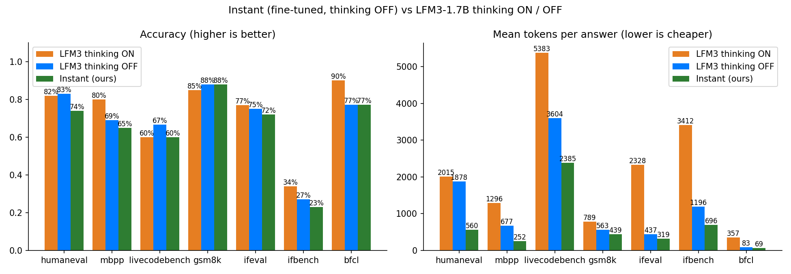

# Step 4: Instant (first fine-tune) vs LFM3-1.7B thinking ON / OFF

Output of `notebooks/Step4_Instant_vs_Base.ipynb` on Kaggle (2x T4, float16), 2026-11-10.

**Setup:**
- **Same 600 questions** as baseline v2, with the same token limits (4,096; LiveCodeBench 8,192), sampling, seed and scorers.
- **ON / OFF answers:** taken from the baseline run.
- **Instant answers:** from the Step 3 LoRA merged into LFM3-1.7B, prompted with thinking OFF.

## Headline

| | LFM3 thinking ON | LFM3 thinking OFF | **Instant (ours)** |
|---|---|---|---|
| Average accuracy (7 benchmarks) | 73.0% | 69.4% | **65.6%** |
| Mean tokens per answer | 2,226 | 1,206 | **674** |
| Answers cut off at the limit | 19% | 7% | **2%** |
| Answers with hidden reasoning | – | 26% | **8%** |
| Wait for 7 sample questions (one at a time, T4) | 526 s | 362 s | **85 s** |

**In one line:** the first Instant model is **1.8x shorter than thinking OFF and 3.3x shorter than thinking ON**, and almost never runs out of budget. But it is **about 4 points less accurate than thinking OFF**. Over all 600 questions, it alone was right on 22 and OFF alone on 44, which is a clear difference (p ≈ 0.009). **The first fine-tune therefore did not reach its goal of beating thinking OFF on accuracy.**

## Per benchmark

| Benchmark | ON | OFF | Instant | Instant vs OFF | Tokens ON / OFF / Instant |
|---|---|---|---|---|---|
| HumanEval+ | 82 | 83 | 74 | −9 | 2015 / 1878 / **560** |
| MBPP+ | 80 | 69 | 65 | −4 | 1296 / 677 / **252** |
| LiveCodeBench v6 | 60 | 67 | 60 | −7 | 5383 / 3604 / **2385** |
| GSM8K | 85 | 88 | **88** | 0 | 789 / 563 / **439** |
| IFEval | 77 | 75 | 72 | −3 | 2328 / 437 / **319** |
| IFBench | 34 | 27 | 23 | −4 | 3412 / 1196 / **696** |
| BFCL | 90 | 77 | **77** | 0 | 357 / 83 / **69** |
| **Average** | **73.0** | **69.4** | **65.6** | **−3.8** | 2226 / 1206 / **674** |

**Paired test of Instant vs OFF.** Per benchmark, no difference is statistically clear. The largest is HumanEval+, where Instant alone was right on 5 questions and OFF alone on 14 (p ≈ 0.06). Together, the benchmarks show a clear loss (22 vs 44, p ≈ 0.009). Details are in `paired_tests.csv`.

## Why accuracy dropped: the fine-tune removed the hidden reasoning that was helping

On code, thinking OFF often still reasoned in secret: 70% of HumanEval+ answers and 60% of LiveCodeBench. The fine-tune stopped that, as intended. But that hidden reasoning was helping:

| HumanEval+ | |
|---|---|
| Questions OFF got right and Instant got wrong | 14 |
| … of which OFF had reasoned in secret | **11** |
| Accuracy of OFF on its *direct* answers (no reasoning) | 20 / 30 = 67% |
| Accuracy of Instant on its *direct* answers | 68 / 92 = **74%** |

So **as a direct answerer, Instant is as good as or better than LFM3** (LiveCodeBench: 9/21 vs 4/12). It is just no longer allowed to think on the hard questions. The training data taught *answer directly*, but very little *new skill*:
- 77% of the targets were answers that thinking OFF already gave directly.
- Only 255 of 2,069 (12%) carried knowledge from thinking ON.

## Tool calls: the parallel-call weakness is not fixed yet

| BFCL category | ON | OFF | Instant |
|---|---|---|---|
| parallel | 10/10 | 6/10 | 6/10 |
| parallel_multiple | 9/10 | 7/10 | 8/10 |
| live_multiple | 9/10 | 8/10 | 7/10 |
| others (simple, multiple, live_simple, irrelevance) | 35/40 | 33/40 | 33/40 |

A typical miss: "status **and** trial date for two cases" got one call per case, with `status` for the first and `trial_date` for the second. It should have asked for both details for each case. The Hermes training data has many multi-call examples, but few of these "split every part of the question" cases.

## What this means

- **What worked:**
  - hidden reasoning 26% → 8% (IFEval and BFCL: 0%);
  - cut-offs 7% → 2% (thinking ON: 19%);
  - answers 1.8x shorter than OFF and 3.3x shorter than ON;
  - about 4–6x less waiting than thinking ON on the sample questions;
  - math (GSM8K 88%) and tool calls (BFCL 77%) kept OFF's accuracy at fewer tokens.
- **What did not:**
  - accuracy is about 4 points below OFF and 7 below ON;
  - code (HumanEval+ −9) and IFBench (−4) lost the most.
- **Not ready to release as "better than thinking OFF".** As it stands, it is an honest "faster and more predictable, slightly less accurate" model.

## Next: round 2 (ideas, in order of expected value)

1. **More skill in the data, fewer easy examples.**
   - Spend generation on questions that thinking OFF gets **wrong** and thinking ON gets **right** (more questions and more ON tries), so most targets carry knowledge from thinking.
   - Drop most "OFF already answered directly" examples; they teach little.
2. **Allow a short, visible plan on code and multi-part tool calls**, the "short reasoning only when needed" product shape. Use correct answers with **brief** reasoning (for example, under 300 tokens) as targets instead of stripping all reasoning.
3. **Targeted tool-call data:** questions that ask for several details or several items, so the model learns to split them into all the needed calls.
4. Optional later: RL (GRPO) with a verifiable reward and a length cap (TNT-style).

## Files

| File | Content |
|---|---|
| `summary.md` / `summary.csv` | Accuracy, tokens, cut-offs, hidden reasoning, time, for all three |
| `instant_vs_base.csv` / `.png` | Comparison table and chart |
| `paired_tests.csv` | Question-by-question McNemar tests (Instant vs OFF, Instant vs ON) |
| `per_question_outcomes.csv` | Every question: right or wrong in ON, OFF and Instant |
| `instant_answers.jsonl.gz` | Every Instant answer with its score. ON / OFF answers are in `../baseline_v2` |
| `speed_test.csv` | One question per benchmark, one at a time. A single sample, so treat the times as rough |
| `worker_gpu*.log`, `template_check.txt` | Run logs, rendered chat template |
